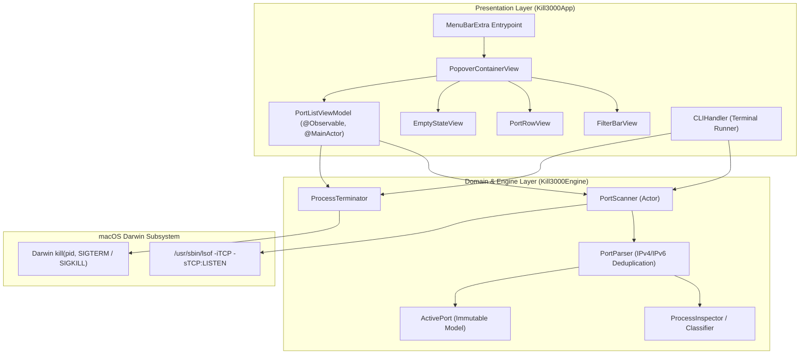
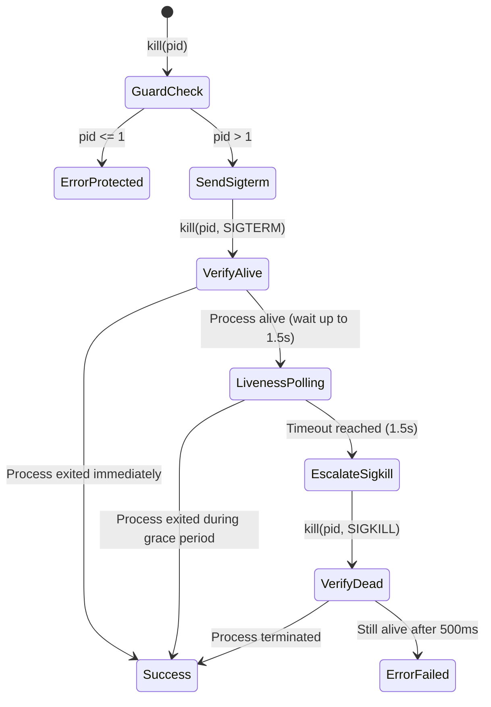

# Kill3000

[](https://github.com/SS20112006/Kill3000/actions/workflows/ci.yml)
[](https://www.apple.com/macos/)
[](https://www.swift.org)
[](LICENSE)
[](#performance--efficiency)

> Ultra-lightweight native macOS menu bar utility to inspect and terminate stuck development servers in one click. Dual GUI & CLI.

---

## ⚡ The Problem

Every developer knows this pain:

```bash
Error: listen EADDRINUSE: address already in use :::3000
```

An orphaned Node, Vite, Next.js, Python, or Go process is holding your port hostage in the background. Finding and killing it traditionally involves tedious terminal commands:

```bash
lsof -iTCP:3000 -sTCP:LISTEN
kill -9 <PID>
```

**Kill3000** eliminates this friction forever. Living discreetly in your macOS menu bar, it automatically detects active local development ports, intelligently classifies them, and lets you terminate stubborn processes or open them in your browser with a single click.

---

## ✨ Features

- **Menu Bar Native Popover**: Seamlessly integrated into the macOS menu bar via SwiftUI `MenuBarExtra` with `.window` style.
- **Intelligent Process Classifier**: Instantly filters development runtimes (`node`, `vite`, `next`, `bun`, `deno`, `python`, `go`, `cargo`, `docker-proxy`, etc.) from background macOS system daemons (`mDNSResponder`, `rapportd`, `cupsd`, etc.).
- **Safe Two-Tier Termination**: Issues graceful `SIGTERM` first, polls process liveness, and escalates to `SIGKILL` only if the process persists beyond 1.5s.
- **POSIX Safety Barrier**: Hardened against dangerous inputs—explicitly protects PID `<= 1` (`launchd`) from being targeted.
- **Graceful Permission Handling**: Non-crashing, non-intrusive warning when attempting to terminate processes owned by `root` (`EPERM`), avoiding unnecessary `sudo` prompts.
- **One-Click Browser Launch**: Click the external link button next to any port to open `http://localhost:<port>` in your default browser.
- **Live Search & Filter**: Real-time filtering by port number or executable name, plus toggle between "Dev Servers" and "All Ports".
- **Dual Mode (GUI & CLI)**: Use the menu bar popover or execute `kill3000 --scan` and `kill3000 --kill <port>` directly from your terminal or automation scripts.
- **Zero Bloat & 0% Idle CPU**: Polling runs strictly while the popover is open (`.onAppear` to `.onDisappear`) and stops immediately when closed. Memory footprint remains under 30MB with zero external binary dependencies.

---

## 🎨 Apple Human Interface Guidelines (HIG)

Kill3000 is crafted to look and feel like a native Apple system utility:

| Guideline | Implementation Detail |
| :--- | :--- |
| **Typography** | Optical sizing with **SF Pro Text** (`<= 19pt`) and **SF Pro Display** (`>= 20pt`). Monospaced digits (`.monospaced`) for strict vertical column alignment of port numbers. |
| **Semantic Materials** | Built using macOS translucent semantic materials (`.ultraThinMaterial`) that adapt to Light/Dark Mode and desktop wallpapers. Zero hardcoded hex colors. |
| **Touch Targets** | Strict minimum physical footprint of **44x44 points** on all interactive action buttons (`.frame(minWidth: 44, minHeight: 44)`). |
| **Sensory Feedback** | Tactile `.sensoryFeedback` triggers: `.impact` on process termination, `.selection` on filter toggle, and `.error` on permission failures. |
| **Accessibility** | All text and UI pairings exceed **WCAG 2.1 AA** minimum contrast ratio (4.5:1). |

---

## 🏗️ Architecture

Kill3000 enforces strict separation of concerns between domain logic and presentation:



### Process Termination State Machine



---

## 🚀 Installation

### Option 1: Direct Download (GitHub Releases)

1. Download the latest `Kill3000.zip` from [GitHub Releases](https://github.com/SS20112006/Kill3000/releases).
2. Unzip and drag `Kill3000.app` into `/Applications`.
3. If macOS Gatekeeper flags an ad-hoc signed app on first launch, open Terminal and run:
   ```bash
   xattr -cr /Applications/Kill3000.app
   ```
4. Launch `Kill3000.app` from Spotlight or Applications.

### Option 2: Homebrew Cask

Install directly using the included Homebrew Cask formula:

```bash
brew install --cask Casks/kill3000.rb
```

### Option 3: Build from Source (Swift Package Manager)

Requirements: macOS 13.0+ and Xcode 15+ / Swift 6.0 command line tools.

```bash
# Clone the repository
git clone https://github.com/SS20112006/Kill3000.git
cd Kill3000

# Build release bundle with ad-hoc signature
./scripts/build-app.sh

# Open the compiled application
open build/Kill3000.app
```

---

## 💻 Command Line Interface (CLI)

Kill3000 can also be used directly from your shell or automation pipelines:

```bash
# Scan and print all listening ports in a formatted table
kill3000 --scan
# or shorthand:
kill3000 -s

# Terminate a stuck process on a specific port
kill3000 --kill 3000
# or shorthand:
kill3000 -k 3000

# Print version
kill3000 --version

# Display help and usage
kill3000 --help
```

### Example CLI Output

```
$ kill3000 --scan
PORT    PID     PROCESS          USER             PROTOCOLS    CATEGORY
---------------------------------------------------------------------------
3000    88162   node             developer        IPv4, IPv6   Dev Server
5173    89201   vite             developer        IPv4         Dev Server
6379    1062    redis-server     developer        IPv4, IPv6   Dev Server
52311   619     rapportd         developer        IPv4, IPv6   macOS System

$ kill3000 --kill 3000
Successfully terminated process 'node' (PID 88162) on port 3000.
```

---

## 🧪 Testing & Verification

Kill3000 is backed by a comprehensive unit, integration, and end-to-end smoke test suite:

```bash
# Run all unit and integration tests with code coverage
swift test --enable-code-coverage

# Run the end-to-end smoke test harness
# Spawns a real TCP server, verifies detection, terminates process, and confirms socket release
chmod +x scripts/smoke-test.sh
./scripts/smoke-test.sh
```

---

## ⚡ Performance & Efficiency

- **Idle CPU Usage**: **0.0%**. Background polling is bound to the SwiftUI view lifecycle (`.onAppear` / `.onDisappear`). When the menu bar popover is closed, all polling tasks are cancelled.
- **Memory Footprint**: Less than **30 MB** resident memory.
- **Fast Startup**: Pure Swift / SwiftUI binary without Electron, Chromium, or webview wrappers.

---

## 📄 License

This project is licensed under the MIT License - see the [LICENSE](LICENSE) file for details.

Copyright (c) 2026 Simão Sousa.
