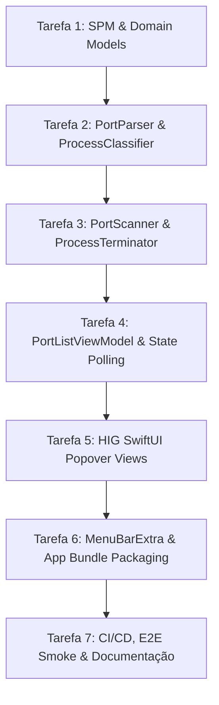

# Kill3000: Plano de Execução & Engenharia (1 Tarefa por Conversa)

Este documento define a estratégia completa de execução do projeto **Kill3000**, decomposta em tarefas estritamente isoladas para serem realizadas **uma tarefa por conversa**, garantindo foco cirúrgico, rigor de testes (TDD), conformidade com as diretrizes da Apple e integridade de versionamento semântico.

---

## 1. Gestão Económica de Tokens & Invariantes Nativas (Zero-Bloat)

Após auditoria detalhada ao consumo de tokens e aos ficheiros de skills disponíveis, constatou-se que as regras universais do utilizador (`RULE[user_global]`) **já contêm nativamente** no prompt de sistema todas as diretrizes fundamentais:
* **Apple HIG & Design Tokens**: Já definidos na Secção 1 (SF Pro Text/Display, WCAG AA 4.5:1, alvos 44x44pt, `.ultraThinMaterial`, feedback háptico). Dispensa o carregamento de `apple-hig-auditor` e do pesado `design-taste-frontend` (~1.200 linhas / web).
* **Versionamento & Conventional Commits 1.0.0**: Já definidos na Secção 4. Dispensa `semantic-git-workflow`.
* **Escada Ponytail & Anti-Over-Engineering**: Já definidos na Secção 5 e 8. Dispensa o carregamento de `ponytail`.
* **Rigor de Verificação & TDD Red-Green**: Já definidos na Secção 6 (Iron Law of Verification e Iron Law of Debugging). Dispensa `verification-before-completion` e `test-driven-development`.
* **Compilação Swift 6**: O compilador nativo do Swift (`swift build` / `swift test`) já aplica estrita verificação de tipos e concorrência (`Sendable`), tornando redundante o `strict-type-verifier` (focado em ASTs TypeScript).

### Política de Ativação de Skills (On-Demand / Sob Demanda)
* **Regra Geral**: **Zero skills carregadas por defeito no início da conversa**. Isto poupa entre **5.000 a 15.000 tokens de contexto por sessão**, mantendo a janela rápida e focada estritamente no código Swift e testes.
* **Exceção / Sob Demanda**:
  - `systematic-debugging`: Apenas se surgir um bug inexplicável durante a execução.
  - `ci-cd-workflow-automation`: Opcionalmente consultada na Tarefa 7 se houver dúvida específica de sintaxe do GitHub Actions.

---

## 2. Decisões de Engenharia & Arquitetura Alinhadas (Entrevista)

Esta secção armazena as decisões de engenharia fora do código acordadas iterativamente:

* **Tópico 1: Assinatura de Código (Codesigning) & Distribuição Inicial**:
  - **Decisão**: **Opção A — Assinatura Ad-hoc local (`codesign -s -`)**.
  - **Racional Técnico**: O Kill3000 é um projeto open-source independente sem necessidade de conta Apple Developer paga (\$99/ano). O script `scripts/build-app.sh` aplica assinatura ad-hoc recursiva (`codesign --force --deep -s - build/Kill3000.app`). Para utilizadores externos via GitHub Releases (.zip/.dmg), o `README.md` disponibilizará instruções claras e transparentes de descarregamento e remoção de quarentena do macOS Gatekeeper (`xattr -cr /Applications/Kill3000.app`).
* **Tópico 2: Gestão de Processos com Privilégios Elevados (`root` / `EPERM`)**:
  - **Decisão**: **Opção A — Feedback Informativo e Não Bloqueante**.
  - **Racional Técnico**: O botão "Kill" permanece sempre disponível e clicável. Se o encerramento falhar com erro POSIX `EPERM` (processo pertence ao `root` ou a outro utilizador), a aplicação não crasha nem pede senhas de administrador (`sudo`). Em vez disso, a linha correspondente apresenta um alerta visual não intrusivo (*"Permissão insuficiente: processo pertence ao root/sistema"*) acompanhado do gatilho de feedback sensorial `.sensoryFeedback(.error)` do SwiftUI.
* **Tópico 3: Ícone e Identidade Visual na Menu Bar**:
  - **Decisão**: **Opção A — SF Symbol Nativo (`network.badge.shield.half.filled` / `bolt.horizontal.circle`)**.
  - **Racional Técnico**: Adota o princípio Ponytail e a conformidade pura com Apple HIG. Sem assets binários adicionais ou ficheiros bitmap pesados, usufruindo da renderização vetorial nativa do macOS, alinhamento ótico com a barra de menus e adaptação automática instantânea a Light/Dark Mode e papéis de parede dinâmicos.
* **Tópico 4: Distribuição via Homebrew Cask & GitHub Releases**:
  - **Decisão**: **Opção A — Pacote `.zip` e Fórmula Homebrew Cask (`Casks/kill3000.rb`)**.
  - **Racional Técnico**: O formato `.zip` é o padrão preferido pelo ecossistema Homebrew Cask e ferramentas de linha de comando no macOS. O script `scripts/build-app.sh` empacota `build/Kill3000.app` diretamente num `Kill3000-v<version>.zip` pronto para anexar aos GitHub Releases. O repositório manterá a fórmula `Casks/kill3000.rb` documentada para instalação direta via `brew tap` ou submissão oficial ao Homebrew.
* **Tópico 5: Estratégia de CI/CD (Matriz de Versões macOS e Cache SPM)**:
  - **Decisão**: **Opção A — Pipeline Ágil no runner Apple Silicon (`macos-14`) com Cache SPM**.
  - **Racional Técnico**: Foco em tempo de ciclo rápido e feedback imediato para pull requests e pushes na `main`. O workflow `.github/workflows/ci.yml` utilizará o runner `macos-14` (Apple Silicon arm64), cache da diretoria `.build` via `actions/cache`, execução de `swift test --enable-code-coverage`, verificação do script `./scripts/build-app.sh` e upload do artefacto `Kill3000.zip`.

---

## 3. Estado de Prontidão da Engenharia (Definition of Readiness)

Com o fecho das 5 decisões arquiteturais, o projeto está **100% planeado e pronto para desenvolvimento**. Todos os detalhes de infraestrutura, segurança, empacotamento e distribuição foram formalizados:

1. **Assinatura**: Ad-hoc local (`codesign -s -`) sem custos de conta Apple Developer.
2. **Segurança POSIX**: Sem `sudo`, tratamento gracioso de `EPERM` com feedback visual/tátil.
3. **Identidade Visual**: SF Symbol nativo monocromático com conformidade total Apple HIG.
4. **Distribuição**: `Kill3000.zip` para GitHub Releases e fórmula `Casks/kill3000.rb` para Homebrew.
5. **CI/CD**: GitHub Actions no runner `macos-14` com cache SPM e testes automatizados.

---

## 3. Divisão de Tarefas: 1 Tarefa por Conversa



---

### Tarefa 1: Fundação do Projeto SPM & Modelos de Domínio
* **Foco da Conversa**: Configurar o ambiente Swift Package Manager e definir as estruturas de dados imutáveis do domínio com tipagem estrita e conformidade com concorrência moderna do Swift 6.
* **Passos de Implementação**:
  1. Criar o ficheiro `Package.swift` declarando:
     - Ferramentas Swift 6.0 (`// swift-tools-version: 6.0`).
     - Plataforma alvo: macOS 13.0+.
     - Targets: `Kill3000Engine` (library), `Kill3000App` (executable), e `Kill3000EngineTests` (testTarget).
     - Ativar verificação estrita de concorrência (`SwiftSettings: .enableExperimentalFeature("StrictConcurrency")`).
  2. Implementar `Sources/Kill3000Engine/Models/ProcessCategory.swift`:
     - Enum com `case development = "Dev Server"` e `case systemDaemon = "macOS System"`.
     - Conformidade com `Sendable`, `CaseIterable`, `Codable`, `Hashable`.
  3. Implementar `Sources/Kill3000Engine/Models/ActivePort.swift`:
     - Estrutura imutável: `port: Int`, `pid: pid_t`, `processName: String`, `commandPath: String?`, `user: String`, `protocols: Set<String>`, `category: ProcessCategory`.
     - Propriedade identificadora: `var id: String { "\(port)-\(pid)" }`.
     - Conformidade com `Identifiable`, `Sendable`, `Equatable`, `Hashable`.
  4. Criar teste inicial em `Tests/Kill3000EngineTests/ActivePortTests.swift` validando criação, unicidade de ID e conformidade `Equatable`.
* **Critérios de Aceitação**:
  - [x] `swift package describe` e `swift build` compilam com sucesso sem warnings de concorrência.
  - [x] `ActivePort` e `ProcessCategory` são 100% thread-safe (`Sendable`).
  - [x] A chave `id` é unívoca e composta por `port-pid`.
  - [x] `swift test` executa e passa com sucesso.
* **Comando de Verificação**:
  ```bash
  swift test
  ```
* **Commit Semântico**:
  ```bash
  git commit -m "feat(engine): initialize swift package and domain models"
  ```

---

### Tarefa 2: Parsing Determinístico e Classificação de Processos
* **Foco da Conversa**: Desenvolver o parser de saída do comando `lsof` com desduplicação de IPv4/IPv6 e o classificador de processos conhecidos de desenvolvimento vs daemons do sistema (TDD puro).
* **Passos de Implementação**:
  1. Escrever testes unitários em `Tests/Kill3000EngineTests/PortParserTests.swift`:
     - Cenário IPv4 (`127.0.0.1:3000`).
     - Cenário IPv6 (`[::1]:3000`).
     - Cenário Wildcard (`*:5173`).
     - Cenário de desduplicação (processo que escuta em IPv4 e IPv6 deve resultar em apenas um `ActivePort` com protocolos `["IPv4", "IPv6"]`).
     - Cenário de linhas inválidas ou ruído do terminal (ignorar graciosamente).
  2. Escrever testes em `Tests/Kill3000EngineTests/ProcessClassifierTests.swift`:
     - Validar que `node`, `vite`, `bun`, `python3`, `go`, `docker-proxy` são classificados como `.development`.
     - Validar que `mDNSResponder`, `rapportd`, `cupsd`, `launchd` são classificados como `.systemDaemon`.
  3. Implementar `Sources/Kill3000Engine/Parsing/PortParser.swift`:
     - Expressão regular rigorosa, imune a ReDoS.
     - Agrupamento por tuplo `(port, pid)` para fundir registos dual-stack.
  4. Implementar `Sources/Kill3000Engine/Services/ProcessInspector.swift`:
     - Classificador estático com conjuntos predefinidos otimizados em `Set<String>`.
* **Critérios de Aceitação**:
  - [ ] Parser extrai com precisão porta, PID, nome do processo e utilizador.
  - [ ] Dual-stack IPv4/IPv6 é desduplicado num único objeto `ActivePort` com ambos os protocolos registados.
  - [ ] Classificação correta de pelo menos 10 ferramentas comuns de dev e 5 daemons do macOS.
  - [ ] Testes unitários com 100% de sucesso.
* **Comando de Verificação**:
  ```bash
  swift test --filter PortParserTests && swift test --filter ProcessClassifierTests
  ```
* **Commit Semântico**:
  ```bash
  git commit -m "feat(engine): implement lsof port parser and process classifier"
  ```

---

### Tarefa 3: Scanner Assíncrono e Terminador de Processos
* **Foco da Conversa**: Implementar o `PortScanner` (Actor Swift que executa `/usr/sbin/lsof` sem bloquear threads) e o `ProcessTerminator` (com barreira de segurança para PID <= 1 e escalonamento SIGTERM -> SIGKILL).
* **Passos de Implementação**:
  1. Criar erros de domínio tipados em `Sources/Kill3000Engine/Services/TerminatorError.swift`:
     - `protectedProcess(pid_t)`
     - `permissionDenied(pid_t)`
     - `processNotFound(pid_t)`
     - `terminationFailed(pid_t, Int32)`
  2. Escrever testes unitários em `Tests/Kill3000EngineTests/ProcessTerminatorTests.swift`:
     - Testar que tentar terminar PID 0 ou PID 1 lança de imediato `TerminatorError.protectedProcess`.
     - Testar comportamento com PID inexistente (captura de `ESRCH`).
  3. Implementar `Sources/Kill3000Engine/Services/PortScanner.swift`:
     - Definido como `actor` para garantir isolamento de concorrência.
     - Executa `/usr/sbin/lsof -iTCP -sTCP:LISTEN -n -P` usando `Process` e `Pipe`.
     - Devolve `[ActivePort]` ordenado crescentemente pelo número da porta.
  4. Implementar `Sources/Kill3000Engine/Services/ProcessTerminator.swift`:
     - Guarda de segurança: impede PIDs `<= 1`.
     - Emissão de `kill(pid, SIGTERM)`.
     - Polling de verificação com timeout de 1.5s via `kill(pid, 0) == 0`.
     - Escalonamento automático para `kill(pid, SIGKILL)` se o processo persistir.
     - Mapeamento de errno POSIX (`EPERM`, `ESRCH`) para `TerminatorError`.
* **Critérios de Aceitação**:
  - [ ] Impossível disparar sinal contra PID 0 ou PID 1.
  - [ ] `PortScanner` executa em background de forma assíncrona sem bloquear o MainActor.
  - [ ] `ProcessTerminator` respeita a progressão elegante (SIGTERM primeiro, SIGKILL como último recurso).
  - [ ] Tratamento explícito de erros sem crash e sem fuga de caminhos internos.
* **Comando de Verificação**:
  ```bash
  swift test
  ```
* **Commit Semântico**:
  ```bash
  git commit -m "feat(engine): implement async port scanner and process terminator"
  ```

---

### Tarefa 4: Gestor de Estado & ViewModel Reativo
* **Foco da Conversa**: Implementar o `PortListViewModel` utilizando o padrão moderno `@Observable` e `@MainActor` do Swift 5.9+/6, orquestrando o ciclo de vida do polling e ações do utilizador.
* **Passos de Implementação**:
  1. Implementar `Sources/Kill3000App/ViewModels/PortListViewModel.swift`:
     - Anotações `@Observable` e `@MainActor`.
     - Estados observáveis: `ports: [ActivePort]`, `searchText: String`, `showAllPorts: Bool`, `isLoading: Bool`, `errorMessage: String?`.
     - Propriedade computada `filteredPorts`: filtra por texto de pesquisa (porta ou nome) e pela flag de daemons do sistema.
     - Métodos de ciclo de vida: `startPolling()` e `stopPolling()` (intervalo de 2 segundos utilizando `Task.sleep` e verificação de cancelamento).
     - Método `kill(port: ActivePort)`: chamada assíncrona ao `ProcessTerminator`, remoção otimista da lista, tratamento de erro com feedback visual.
     - Método `openInBrowser(port: Int)`: abertura segura de `http://localhost:\(port)` via `NSWorkspace.shared.open()`.
  2. Adicionar testes unitários para a lógica de filtragem e estado do ViewModel em `Tests/Kill3000AppTests/PortListViewModelTests.swift`.
* **Critérios de Aceitação**:
  - [ ] Polling pode ser iniciado e cancelado sem reter tarefas em background.
  - [ ] Filtragem por pesquisa responde instantaneamente sem atrasos de frame.
  - [ ] Erros de terminação preenchem `errorMessage` amigável sem fechar a aplicação.
  - [ ] Conformidade total com concorrência (`@MainActor`).
* **Comando de Verificação**:
  ```bash
  swift test
  ```
* **Commit Semântico**:
  ```bash
  git commit -m "feat(app): implement observable port list view model"
  ```

---

### Tarefa 5: Componentes de Interface SwiftUI & Apple HIG
* **Foco da Conversa**: Construir as views SwiftUI do popover respeitando integralmente as Apple Human Interface Guidelines, materiais nativos (`.ultraThinMaterial`), tipografia SF Pro e alvos de toque/clique de 44x44pt.
* **Passos de Implementação**:
  1. Implementar `Sources/Kill3000App/Views/FilterBarView.swift`:
     - Campo de busca moderno com ícone SF Symbol `magnifyingglass` e botão de limpar.
     - Segmented picker com opções: "Dev Servers" e "All Ports".
  2. Implementar `Sources/Kill3000App/Views/PortRowView.swift`:
     - Exibição da porta com fonte monoespaçada (`.font(.system(.body, design: .monospaced))`).
     - Badges discretos para protocolos (IPv4 / IPv6) e nome do processo.
     - Botão "Abrir no Browser" (ícone `safari` ou `arrow.up.right.square`).
     - Botão destrutivo "Kill" estilizado com confirmação tátil e alvo mínimo de 44x44 pontos (`.frame(minWidth: 44, minHeight: 44)`).
  3. Implementar `Sources/Kill3000App/Views/EmptyStateView.swift`:
     - Visual limpo com símbolo `checkmark.circle` ou `network.slash` quando não existem portas ativas.
  4. Implementar `Sources/Kill3000App/Views/PopoverContainerView.swift`:
     - Fundo translucente com material nativo do macOS (`.background(.ultraThinMaterial)`).
     - Tipografia SF Pro Text / Display com ajuste ótico.
     - Gatilhos de feedback tátil (`.sensoryFeedback(.impact)`, `.sensoryFeedback(.selection)`, `.sensoryFeedback(.error)`).
* **Critérios de Aceitação**:
  - [ ] Todos os botões interativos possuem footprint mínimo de 44x44 pontos.
  - [ ] Cores e contrastes cumprem WCAG 2.1 AA (mínimo 4.5:1) em Light e Dark Mode.
  - [ ] Zero cores hexadecimais rígidas para a janela; uso estrito de materiais semânticos da Apple.
  - [ ] Layout fluido e adaptativo com largura fixa de ~360px e altura dinâmica até 480px.
* **Comando de Verificação**:
  ```bash
  swift build
  ```
* **Commit Semântico**:
  ```bash
  git commit -m "feat(ui): implement HIG-compliant menu bar popover views"
  ```

---

### Tarefa 6: Entry Point MenuBarExtra & Empacotamento do Bundle macOS
* **Foco da Conversa**: Conectar a interface à Menu Bar do macOS com `MenuBarExtra`, garantir paragem do polling quando fechado (0% de CPU), e criar o harness de empacotamento `Kill3000.app` com `LSUIElement = true`.
* **Passos de Implementação**:
  1. Implementar `Sources/Kill3000App/App/Kill3000App.swift`:
     - Estrutura `@main` com `MenuBarExtra("Kill3000", systemImage: "network.badge.shield.half.filled")`.
     - Vinculação dos modificadores `.onAppear` e `.onDisappear` no content view para chamar `viewModel.startPolling()` e `viewModel.stopPolling()`.
  2. Criar ficheiro de configuração `Resources/Info.plist`:
     - Incluir `LSUIElement` como `<true/>` para ocultar o ícone do Dock.
     - Definir Bundle Identifier `com.simaosousa.kill3000` e versão `1.0.0`.
  3. Criar script de automação de build `scripts/build-app.sh`:
     - Executar `swift build -c release`.
     - Criar estrutura de diretórios `build/Kill3000.app/Contents/{MacOS,Resources}`.
     - Copiar binário compilado e ficheiro `Info.plist`.
     - Aplicar assinatura ad-hoc (`codesign --force --deep -s - build/Kill3000.app`).
* **Critérios de Aceitação**:
  - [ ] Aplicação corre a partir do bundle `.app` e aparece exclusivamente na barra de menus (sem ícone no Dock).
  - [ ] Quando o popover fecha, o polling cessa e o uso de CPU desce para 0%.
  - [ ] Clicar no ícone da barra de menus abre o popover instantaneamente.
* **Comando de Verificação**:
  ```bash
  chmod +x scripts/build-app.sh && ./scripts/build-app.sh
  ```
* **Commit Semântico**:
  ```bash
  git commit -m "feat(app): configure menubarextra entrypoint and app bundle packaging"
  ```

---

### Tarefa 7: Pipeline CI/CD, Teste de Fumo E2E e Documentação
* **Foco da Conversa**: Automatizar o pipeline de validação contínua no GitHub Actions, implementar um script de teste de fumo em processo real e finalizar o `README.md` de nível de portfólio.
* **Passos de Implementação**:
  1. Criar `.github/workflows/ci.yml`:
     - Disparo em push e pull_request na branch `main`.
     - Runner `macos-14` / `macos-15`.
     - Steps: checkout, seleção de Xcode, `swift test --enable-code-coverage`, `./scripts/build-app.sh`.
  2. Criar script de teste de fumo `scripts/smoke-test.sh`:
     - Inicia um servidor TCP mock temporário em background na porta 3000.
     - Invoca o scanner ou CLI para verificar deteção da porta 3000.
     - Envia comando de terminação e valida que a porta 3000 foi libertada e o processo morreu.
  3. Atualizar `README.md`:
     - Badges de CI, licença MIT, plataforma macOS 13+.
     - Demonstração visual / diagrama de arquitetura Mermaid.
     - Instruções de compilação rápida via SPM e via script.
     - Secção de Performance & Apple HIG.
* **Critérios de Aceitação**:
  - [ ] Workflow de CI passa localmente e a sintaxe YAML é válida.
  - [ ] Script de teste de fumo confirma deteção e terminação em ambiente real sem erros.
  - [ ] `README.md` completo, sem placeholders e pronto para apresentação em portfólio.
* **Comando de Verificação**:
  ```bash
  chmod +x scripts/smoke-test.sh && ./scripts/smoke-test.sh
  ```
* **Commit Semântico**:
  ```bash
  git commit -m "ci(pipeline): add github actions workflow and end-to-end smoke harness"
  ```
